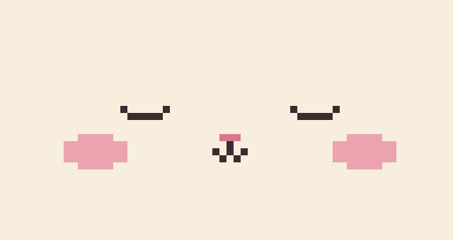
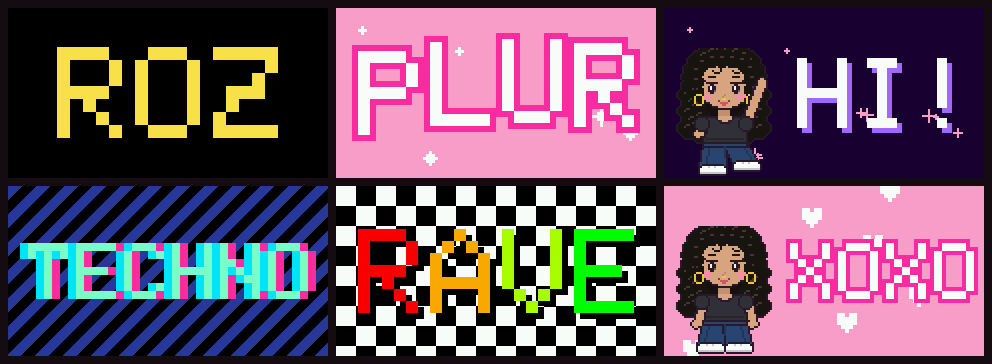
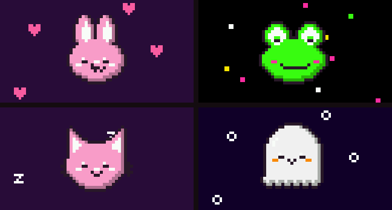
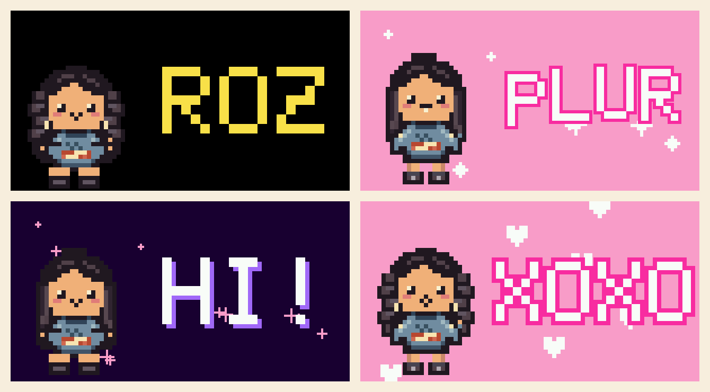
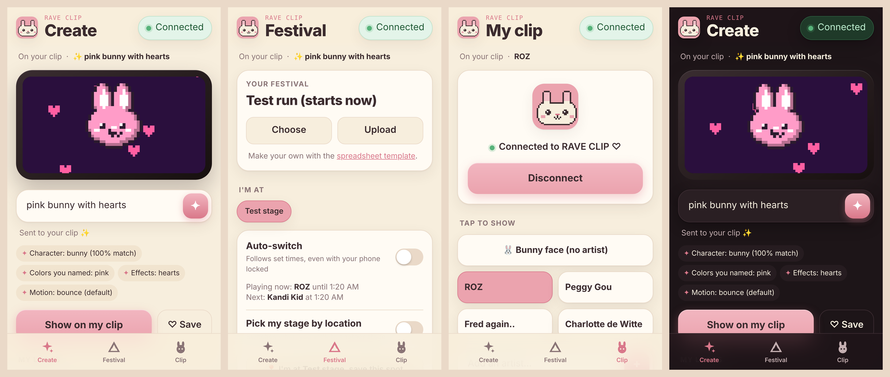

# Rave Clip

**A pixel-screen hair clip for raves that knows who's playing, and an on-device AI that turns what you type into animated scenes. No cloud, no accounts, works with no signal.**

<p>
  
  
  
  
</p>

Rave Clip is a wearable built on an ESP32-S3 board with a small color screen, housed in a 3D-printed bunny shell. A phone web app talks to it over Bluetooth LE. The clip can:

- **Follow the lineup.** Load a festival schedule and the clip switches to each artist's look when their set starts, on its own, even with the phone locked in your pocket.
- **Know which stage you're at.** The app uses GPS to pick the nearest stage and sends that stage's lineup.
- **Show anything you type.** Type *"ROZ invert colors fast"* and a small AI model running on the phone builds a full scene: the words, text effect, speed, colors, background pattern and a pixel avatar.
- **Sleep when nothing's on.** With no artist playing, it shows a blinking pixel bunny face.

## Why offline-first

Two hard constraints shaped the design:

1. **Festivals have no signal.** Tens of thousands of phones on one cell tower means cloud APIs just don't respond. Every feature has to work in airplane mode once the app has loaded.
2. **The clips are gifts.** Friends should be able to use theirs without signing up for anything, paying for API credits, or relying on a server I keep running.

So there is no backend. The schedule logic, the AI model and the rendering all run on the phone and the clip.

## How it works

```
 ┌──────────── iPhone (web app in Bluefy) ────────────┐          ┌──── Clip (ESP32-S3) ────┐
 │                                                    │          │                         │
 │  schedule.js   festival JSON/CSV → current set ────┼── BLE ──▶│  auto mode: own clock   │
 │  geolocation   nearest stage (20 s dwell, 150 m)   │          │  switches sets itself   │
 │                                                    │          │                         │
 │  "ROZ invert colors fast"                          │          │  scene.h renders:       │
 │     │ MiniLM-L6 (int8, wasm) → word vectors        │          │  text fx, backgrounds,  │
 │     │ scene model (my trained head, pure JS)       │          │  avatar sprites         │
 │     ▼                                              │          │                         │
 │  fx=invert;sp=3;fg=FFFFFF;bg=000000;…;t=ROZ  ──────┼── BLE ──▶│  same pixels as the     │
 │  scene.js draws a pixel-exact preview              │          │  phone preview          │
 └────────────────────────────────────────────────────┘          └─────────────────────────┘
```

### Bluetooth protocol

One GATT service with a characteristic per feature: artist name, schedule, AI look and scene. Payloads are short UTF-8 text lines (for example `S|<start>|<end>|<artist>` for a set, or a `key=value;…` scene line up to 200 bytes) so they're easy to debug with any BLE app. Full spec: [docs/PROTOCOL.md](docs/PROTOCOL.md).

The schedule is pushed once with the current time. After that the clip keeps its own clock and switches by itself, so it works while iOS has suspended the web app.

### Scene engine

The clip and the app share one scene format and draw it the same way: 9 text effects (scroll, wave, glitch, invert, rainbow, typewriter…), 3 letter styles, 9 background patterns and an animated pixel avatar with two hairstyles. During development, the JavaScript preview and the C++ renderer were checked against each other and produced identical pixels on every test scene. Flashing effects are capped at 3 per second for photosensitivity safety.

The avatar uses my own hand-made retro sprites. `ai/avatar/extract_gif_sprites.py` pulls them out of the GIF sheets pixel-exact, and `ai/make_scene_assets.py` run-length-encodes them into `festival_clip/scene_assets.h` and `web-app/scene-assets.js`.

### On-device AI

**Version 1, embedding matcher** (`web-app/ai-designer.js`): MiniLM sentence embeddings compared against descriptions of every character, effect, motion and color mood. Words it never saw still work by meaning (*kitty* → cat, *strawberry* → cherry).

**Version 2, trained scene model** (`ai/scene_ai/`): a model I train myself that reads a sentence and fills in every scene setting.

- **Encoder:** frozen all-MiniLM-L6-v2 (the same 23 MB int8 model the app already loads), one vector per word.
- **Head:** a small 2-layer transformer (d=128, 4 heads) written by hand in PyTorch, with
  - a per-word tagging output that picks which words to put on screen, and
  - one attention-pooled classifier per setting (effect, speed, style, colors, background, avatar, hair).
- **Data:** 40,000 synthetic prompt → scene pairs from `scene_data.py`, plus my own examples in `my_examples.py`, weighted 30×.
- **Export:** int8-quantized weights, about 0.4 MB (`scene-ai.bin`).
- **Inference:** a hand-written JavaScript engine (`web-app/scene-ai.js`) that runs the same math as the Python model, so no ML runtime is needed for the head.

Results from a test training run: **96% fully correct on 30 hand-written test prompts** that are phrased differently from the training data, and the JavaScript inference matched PyTorch on all 330 checked outputs. These are from one test run, not a formal benchmark. The trained `scene-ai.bin` isn't committed. You make your own with the notebook (see below).

**Experiment, paused:** `ai/dataset/` holds a procedural pixel-art style engine and dataset builder (33 subjects × 15 hues × 7 expressions × 9 accessories, 32-color palette) for a future text-to-sprite generator.

## Tech stack

| Part | Tech |
|---|---|
| Clip hardware | LILYGO T-Display S3 (ESP32-S3, 1.9" 170×320 color LCD), 1100 mAh LiPo |
| Firmware | Arduino C++, esp32 core 3.2.0, GFX Library for Arduino, ESP32 BLE |
| Web app | Vanilla JS PWA (ES modules, service worker), Web Bluetooth, Geolocation API, Canvas |
| AI in the browser | transformers.js (MiniLM-L6-v2, int8, wasm) + hand-written JS transformer inference |
| Training | PyTorch, ONNX Runtime, Hugging Face tokenizers, Kaggle notebook (CPU) |
| Asset pipeline | Python + Pillow, sprites run-length-encoded into C headers and JS |
| Enclosure | OpenSCAD, printed in SLS nylon and hand-painted |

## Build it

### 1. Flash the clip

1. Install the [Arduino IDE](https://www.arduino.cc/en/software), then add the ESP32 boards package and pick version **3.2.0** (newer versions break GFX Library for Arduino with `gpio_num_t` errors).
2. Library Manager: install **GFX Library for Arduino**.
3. Open `festival_clip/festival_clip.ino`. The `.h` files must stay in the same folder.
4. Tools: board **ESP32S3 Dev Module**, PSRAM **OPI PSRAM**, then upload.

It advertises as `RAVE CLIP`. You can test it with any BLE app (such as nRF Connect) by writing an artist name to the artist characteristic.

### 2. Run the web app

The app is static files with no build step. Web Bluetooth needs HTTPS (or `localhost`):

```bash
cd web-app
python -m http.server 8000      # then open http://localhost:8000 in Chrome
```

To use it on a phone, host the `web-app` folder on any static host (Netlify, GitHub Pages…). On iPhone, open it in **Bluefy**, since Safari doesn't support Web Bluetooth. The first AI use downloads MiniLM (~23 MB). After that it's cached for offline use.

Festival schedules go in `web-app/schedules/` (see `example-fest.json`), or users can upload a CSV in the app (`schedule-template.csv`).

### 3. Train the scene AI (optional)

1. On [Kaggle](https://www.kaggle.com), import `ai/scene_ai/train-scene-ai.ipynb`, turn on internet access (CPU is enough), and Run All. It takes about 20 minutes.
2. Add your own phrasing in the "Your own examples" cell first if you want.
3. Download `scene-ai.bin` and put it next to `web-app/index.html`. The app switches to the trained model automatically.

To train locally instead: `python ai/scene_ai/train.py --minilm <path to MiniLM ONNX folder>`. The notebook is generated from the `.py` files by `make_notebook.py`.

### 4. Print the shell

`hardware/bunny-shell/` has the OpenSCAD source and the front, back and divider STLs, sized for the T-Display S3 and a 1100 mAh battery with a 1.25 mm connector.

## Project structure

```
festival_clip/          ESP32-S3 firmware (Arduino sketch)
  festival_clip.ino       BLE service, schedule/auto mode, artist looks, bunny face
  scene.h                 scene renderer: text effects, backgrounds, avatar
  ai_look.h               v1 AI "look" renderer (characters + effects)
  scene_assets.h          generated: font + avatar sprites (RLE)
  sprites.h               generated: 24×24 character sprites
web-app/                Phone app (PWA)
  index.html, app.js      UI: Create / Festival / Clip tabs
  clip-ble.js             Bluetooth protocol
  schedule.js             schedule parsing (JSON/CSV), current set, stage by GPS
  scene.js, scene-ui.js   scene format + pixel-exact preview + designer
  scene-ai.js             trained model inference in plain JS
  ai-designer.js, ai-ui.js  embedding matcher + AI tab
  sw.js                   offline cache
ai/
  scene_ai/               model, synthetic data, training script, Kaggle notebook, test prompts
  avatar/                 my sprite sheets + extraction / preview tools
  dataset/                pixel-art style engine (paused experiment)
  make_scene_assets.py    builds scene_assets.h + scene-assets.js
  make_sprites.py         builds sprites.h + sprites.js
hardware/bunny-shell/   OpenSCAD + STL files for the clip shell
docs/                   protocol spec, screenshots, previews
```

## Roadmap

- **Retrieval for the scene AI (not built yet):** look up saved scenes and examples close to what you typed (MiniLM retrieval, fully offline) and use them to guide the scene model, so it picks up your own style over time.
- Text-to-sprite generator trained on the `ai/dataset` style engine.
- App Store app wrapping the same web app and Bluetooth protocol.

<p>
  
</p>
